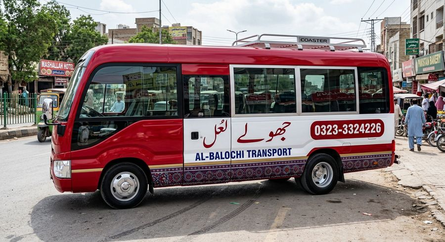
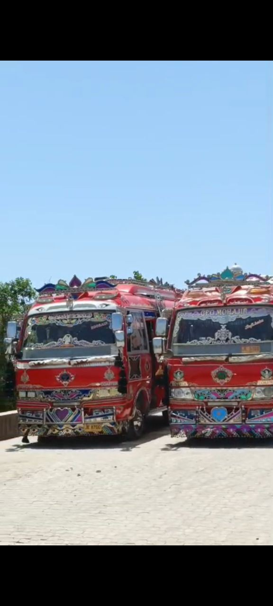
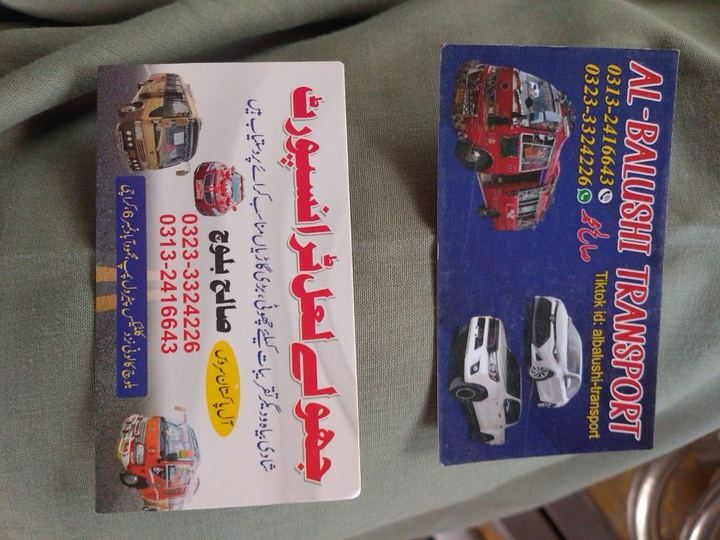
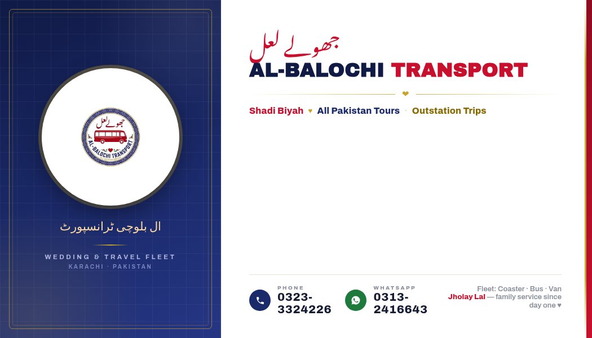
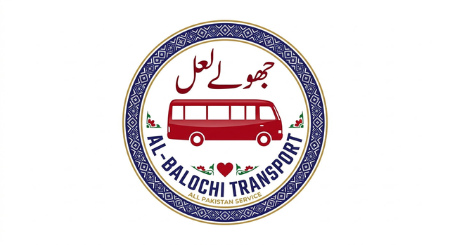

# 🚌 جھولے لعل + AL-BALOCHI TRANSPORT

**Shadi Biyah + All Pakistan Tours** — Karachi ki apni family-run transport service.

A bilingual (Urdu + English), mobile-first, single-page website for a real Karachi transport business — the merger of two family brands, **Jholay Lal** (جھولے لعل) and **AL-Balochi Transport** (ال بلوچی ٹرانسپورٹ), into one unified identity.



## ✨ Features

- **Fully bilingual** — Urdu (Noto Nastaliq) + English (Archivo Black), proper RTL handling
- **Mobile-first responsive** — looks great on any phone, tablet, or desktop
- **WhatsApp booking form** — the booking form opens WhatsApp with the customer's message pre-filled (no backend needed)
- **6 complete sections** — Hero, Services, Fleet Gallery (lightbox), About, Booking/Contact, Footer
- **Brand-accurate design** — Cherry Laal `#C8102E`, Ajrak Indigo `#1B2A6B`, Gold `#C9A227`, Cream `#FBF6EC`
- **SEO ready** — meta description, keywords, Open Graph + Twitter cards, semantic HTML
- **Floating WhatsApp button** with pulse animation + call-to-action everywhere
- **Fleet gallery with lightbox** — 10 real vehicle photos + livery & business-card concepts

## 🖼️ Screenshots

| Hero | Services | Fleet |
|---|---|---|
|  |  |  |

| Livery Concept | Business Card | Logo |
|---|---|---|
|  |  |  |

## 🎨 Brand Identity

| Element | Value |
|---|---|
| Colors | Cherry Laal `#C8102E` · Ajrak Indigo `#1B2A6B` · Gold `#C9A227` · Cream `#FBF6EC` |
| English font | Archivo Black / Archivo |
| Urdu font | Noto Nastaliq Urdu |
| Tagline | Shadi Biyah + All Pakistan Tours |
| Phone | 0323-3324226 |
| WhatsApp | 0313-2416643 |

## 🛠️ Tech Stack

- Plain HTML5 + CSS3 + vanilla JavaScript — zero build step, zero dependencies
- Google Fonts (Archivo Black, Archivo, Noto Nastaliq Urdu)
- No framework, no bundler — a single `index.html` + `images/` you can host anywhere

## 🚀 Live Demo

- **GitHub Pages:** https://mohdabrarbaloch-arch.github.io/jholay-lal-transport/
- **Original hosted version:** https://static.teamily.ai/sites/c2530a64-0b8e-4ef3-ba9c-d634aa2ab466/webpages/jholay-lal-website/index.html

## 📦 Installation

The site is static — just open it or serve the folder:

```bash
# clone
git clone https://github.com/mohdabrarbaloch-arch/jholay-lal-transport.git
cd jholay-lal-transport

# option 1: open directly
open index.html

# option 2: serve locally (any static server)
python3 -m http.server 8080
# then visit http://localhost:8080
```

### Deploy to GitHub Pages

1. Push this repo to GitHub
2. Repo **Settings → Pages**
3. Source: **Deploy from a branch** → `main` / root (`/`)
4. Done — live at `https://<username>.github.io/jholay-lal-transport/`

## 📞 Contact

- **Call:** 0323-3324226
- **WhatsApp:** 0313-2416643
- **Services:** Shadi Biyah / Wedding Transport · All Pakistan Tours · Karachi & Outstation Trips · Special Occasions

## 📄 License

[MIT](LICENSE) © Abrar Baloch — built for the Jholay Lal + AL-Balochi Transport family business.
